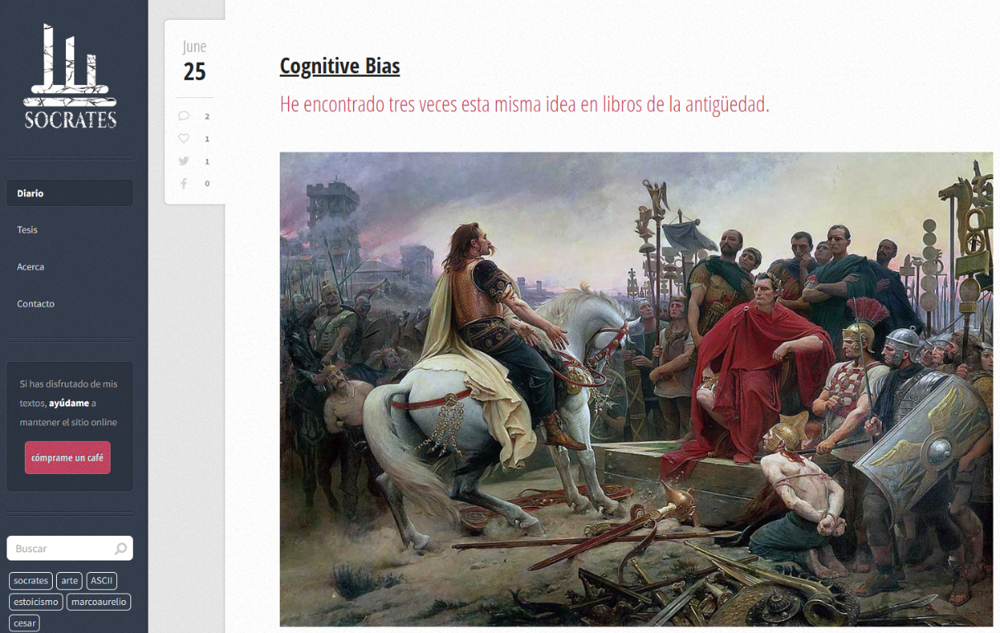
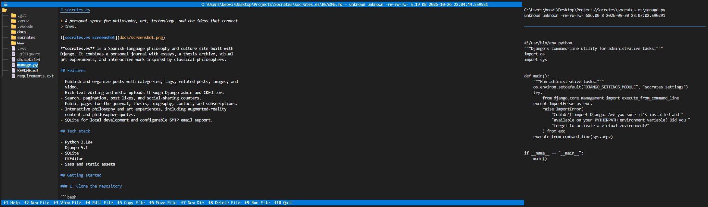

# socrates.es

> A personal space for philosophy, art, technology, and the ideas that connect
> them.



**socrates.es** is a Spanish-language philosophy and culture site built with
Django. It combines a personal journal with essays, a thesis archive, visual
art experiments, and interactive work inspired by classical philosophers.

## About the author

Kevin is a philosopher, educator, and interdisciplinary artist who describes
himself as “the worst disciple of Socrates.” He holds a degree in Philosophy
from the University of Havana (2004), a master's degree in Art History from
the University of Havana (2011), and an Associate in Science in Computer
Programming and Analysis from Miami Dade College (2019).

He has taught at the University of the Arts of Cuba, the University of Havana,
and Miami Dade College. His conference work includes *Beyond the Hyphen:
Approaching a Post Geographic Cuba* at Princeton University (2014) and the
IGCAAV Permanent Seminar at the University of Guadalajara (2017).

His artistic and literary work takes an interdisciplinary approach, with a
particular interest in how new technologies reveal the communication systems
behind contemporary culture. His work has appeared in exhibitions including
*Ojalá!* (Zeitgenössische kubanische Kunst, Berlin, 2015), [*Hope* at
ESMoA](https://esmoa.org/experience/hope/) (Los Angeles, 2017), and *Athens
Open Art* (Art.Number23, Athens, 2022). He also received second place in the
[Samsung Digital Art Competition](https://www.samsung.com/es/lifestyle-tvs/the-frame/premios-arte-digital)
at the BLESS Hotel Madrid.

He created [El Diletante Digital
(2006–2011)](/static/edd/index.html), a project whose research was published
in the book [*Perspectivas del Arte
Digital*](https://www.amazon.com/Perspectiva-del-arte-digital-Spanish/dp/B08LNL5BW8)
(Casa Editorial Ex Libris, Mexico, 2020). Related publications include
[*Perspectivas del Arte Digital (Outlooks on Digital
Art)*](https://www.hypermediamagazine.com/arte/artes-visuales/perspectivas-del-arte-digital/)
and [*El Diletante Digital, de la Literatura Digital a los Nuevos
Medios*](https://artepoli.com/el-diletante-digital/).

The site's original writing, photography, and video are created by the author,
apart from reproduced artwork. The texts in the [thesis
section](/tesis) come from his Philosophy degree thesis, the photographs were
taken during trips to Greece, and the videos reimagine philosopher busts with
the help of artificial intelligence.

## Features

- Publish and organize posts with categories, tags, related posts, images, and
  video.
- Rich-text editing and media uploads through Django admin and CKEditor.
- Search, pagination, post likes, and social-sharing counters.
- Public pages for the journal, thesis, biography, contact, and subscriptions.
- Interactive philosophy and art experiences, including augmented-reality
  content and philosopher quotes.
- SQLite for local development and configurable SMTP email support.

## Tech stack

- Python 3.10+
- Django 5.1
- SQLite
- CKEditor
- Sass and static assets

## Getting started

### 1. Clone the repository

```bash
git clone https://github.com/beovideskevin/socrates.es.git
cd socrates.es
```

### 2. Create and activate a virtual environment

Windows PowerShell:

```powershell
py -m venv .venv
.venv\Scripts\Activate.ps1
```

macOS/Linux:

```bash
python3 -m venv .venv
source .venv/bin/activate
```

### 3. Install dependencies

```bash
python -m pip install --upgrade pip
python -m pip install -r requirements.txt
```

### 4. Configure environment variables

Create a `.env` file in the project root. At minimum, set a Django secret key:

```dotenv
SECRET_KEY=replace-with-a-long-random-value
```

The application also supports the following optional settings:

| Variable | Purpose |
| --- | --- |
| `EMAIL_HOST` | SMTP server hostname |
| `EMAIL_PORT` | SMTP server port (defaults to `587`) |
| `EMAIL_HOST_USER` | SMTP username |
| `EMAIL_HOST_PASSWORD` | SMTP password |
| `EMAIL_USE_TLS` | Enable TLS (defaults to `True`) |
| `EMAIL_USE_SSL` | Enable SSL (defaults to `False`) |
| `TURNSTILE_SECRET` | Cloudflare Turnstile secret |
| `ADMIN_USER_NAME` | Name used for error notifications |
| `ADMIN_USER_EMAIL` | Address used for error notifications |
| `SEND_ERROR_EMAILS` | Enable error email notifications |

Keep `.env` out of version control; it is already included in `.gitignore`.

### 5. Prepare the database

```bash
python manage.py migrate
python manage.py createsuperuser
```

### 6. Start the development server

```bash
python manage.py runserver
```

Open <http://127.0.0.1:8000/> in your browser. The administration area is
available at <http://127.0.0.1:8000/admin/>.

## Noon Commander

The project includes **Noon Commander**, a Textual terminal file manager
available as a Django management command. It lets you browse the project,
preview files, edit or run files, and perform common file operations from the
terminal.

Run it from the project root after activating the virtual environment:

Windows PowerShell:

```powershell
.venv\Scripts\Activate.ps1
python manage.py noon .
```

You can open a specific folder by passing its path:

```powershell
python manage.py noon "C:\path\to\folder"
```

On macOS/Linux:

```bash
source .venv/bin/activate
python manage.py noon .
```

Use `--nano` to configure the commander to use Nano instead of Vim when
editing files:

```bash
python manage.py noon . --nano
```

To see all command options:

```bash
python manage.py help noon
```



The main keyboard shortcuts are:

| Key | Action |
| --- | --- |
| `F1` | Help |
| `F2` | New file |
| `F3` | View file |
| `F4` | Edit file |
| `F5` | Copy file |
| `F6` | Move file |
| `F7` | New directory |
| `F8` | Delete file |
| `F9` | Run file |
| `F10` | Quit |

## Main routes

| Route | Description |
| --- | --- |
| `/` | Journal and latest posts |
| `/tesis` | Philosophy thesis |
| `/acerca` | About the author |
| `/contacto` | Contact form |
| `/buscar` | Search |
| `/arte` | Art section |
| `/ar` | Augmented-reality experience |
| `/aart` | Augmented-art experience |
| `/quotes/<slug>` | Philosopher quotes |
| `/admin/` | Content administration |

## Project layout

```text
.
├── manage.py              # Django command-line entry point
├── socrates/              # Project settings, URLs, ASGI, and WSGI
├── www/                   # Main application, models, views, templates, and assets
├── docs/                  # Documentation assets
├── requirements.txt       # Python dependencies
└── db.sqlite3             # Local database (created after migrations)
```

## Content management

Use the Django admin to create categories, tags, posts, comments, subscribers,
videos, and interactive artwork. Uploaded content is stored under the
configured media directory. For production deployments, configure a persistent
media backend and run:

```bash
python manage.py collectstatic
```

## License and attribution

The site’s original writing, photography, and video belong to the author unless
otherwise noted. Artwork reproduced on the site remains the property of its
respective creators.

Visit the live site at <https://www.socrates.es>.
